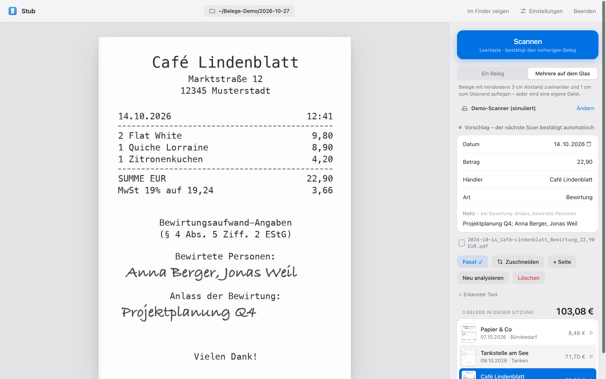
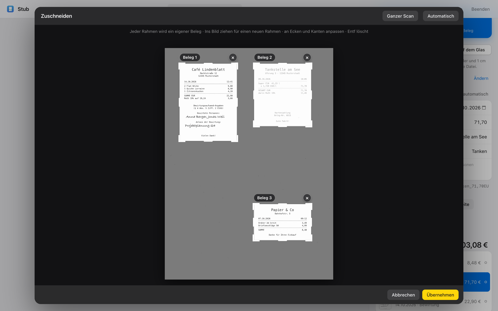
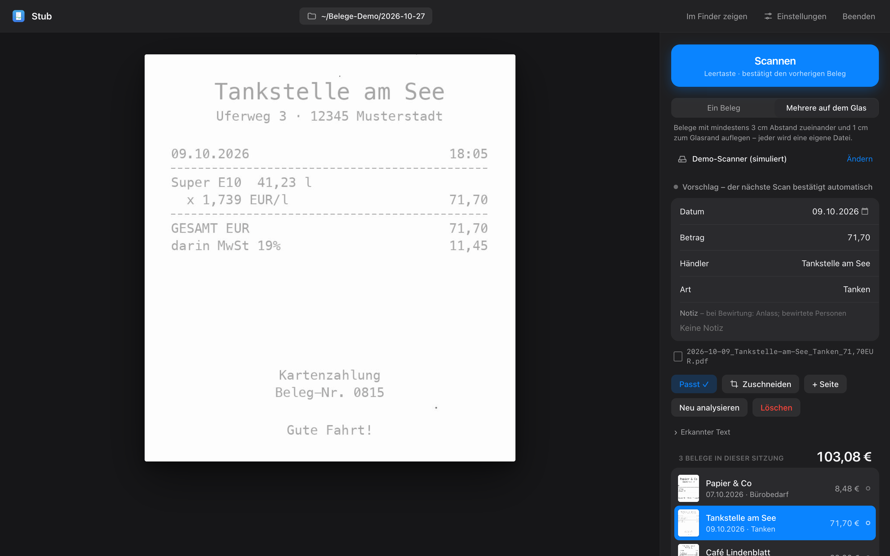
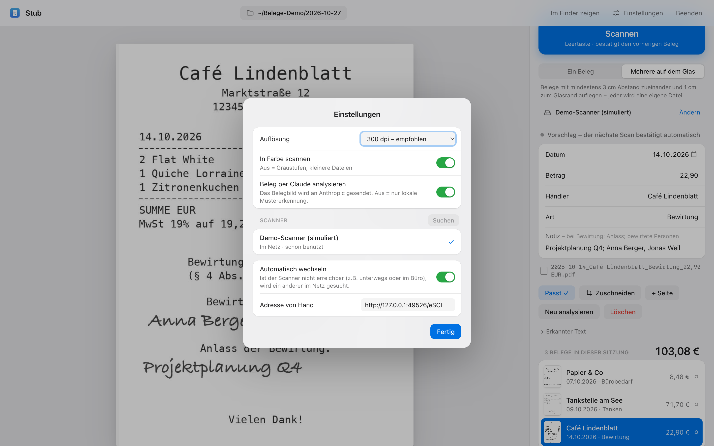

# Stub

[](https://github.com/RobStraubm/stub/actions/workflows/ci.yml)

*Scan a receipt, get a named, searchable PDF.* Stub turns a network scanner and a Mac into a receipt inbox for German bookkeeping: lay receipts on the glass, press the space bar, and each one comes out cropped, read, renamed and listed, ready for your accounting tool.



**English summary** · Deutsche Kurzanleitung unten

- **Any AirScan scanner, no driver.** Stub talks eSCL, the protocol most Wi-Fi printers speak. It finds scanners via Bonjour, remembers the ones you used, and switches by itself when the usual one is out of reach (home vs. office). It reads glass size and resolutions from the device, so unknown models work too.
- **Several receipts per scan.** Receipts lying side by side are cut apart into one PDF each, including faded thermal paper. When the automatic cut is wrong, a crop editor lets you draw the areas by hand on the original scan.
- **Claude reads the receipt.** The page images go to Claude through the Claude Code CLI, which fills in date, merchant, kind of expense, gross amount and, for business meals, the occasion and guests as written on the receipt, handwriting included. Without Claude, simple pattern matching fills in date, amount and merchant.
- **Searchable PDFs, tidy filing.** macOS Vision recognises the text, which goes into the PDF as an invisible layer (Finder and Spotlight find it). Each PDF is named after its fields, e.g. `2026-10-14_Café-Lindenblatt_Bewirtung_22,90EUR.pdf`, and listed in a CSV per scan day.
- **Keyboard first.** The space bar scans the next receipt and confirms the previous one. Every field stays editable.
- **Local by design.** A small Python server on 127.0.0.1 with a page in the browser. Scans, PDFs and lists stay on the Mac; only the AI step sends page images to Claude, and it can be switched off.
- Tested: 41 tests on every push (GitHub Actions), from receipt detection on synthetic scans to the eSCL protocol against a simulated scanner.
- Built with [Claude Code](https://claude.com/claude-code). License: [AGPL-3.0](LICENSE).

## Why

Small businesses in Germany keep every receipt, and business meals need the occasion and the guests written on them (§ 4 Abs. 5 Nr. 2 EStG). In practice that means a shoebox of fading thermal paper, phone photos at odd angles and an evening of typing dates and amounts into the accounting tool. Stub moves that work to the moment the receipts go on the scanner: one press, and the receipt is a correctly named, searchable PDF with its data already in a list.

## How it works

```
 Scanner ◄─eSCL/HTTP─► scanner.py ──raw scan──► regions.py ──one image per receipt──► analysis.py
 (found via Bonjour)   find, switch,            find receipts on the glass,          OCR (macOS Vision)
                       read capabilities        crop, flag edges                     + Claude reads the image
                                                                                             │
 Browser ◄─HTTP 127.0.0.1─► server.py ◄────── session.py ◄──────── filing.py ◄────────────────┘
 (static/index.html)        API, origin check  receipts, recrop,   searchable PDF, file name,
                                               append pages        CSV per scan day
```

| Module | Purpose |
|---|---|
| `stub/scanner.py` | Bonjour discovery, choosing and switching scanners, `ScannerCapabilities`, the eSCL scan job |
| `stub/regions.py` | Finds receipts on the raw scan and crops them |
| `stub/analysis.py` | Text recognition with Vision, the fenced-in Claude call, pattern-matching fallback |
| `stub/filing.py` | PDF with invisible text layer, file names, daily CSV list |
| `stub/session.py` | Receipts of the current session: scan, analyse, recrop, add pages, delete |
| `stub/server.py` | Local HTTP server and API for the page |
| `stub/static/index.html` | The interface: one page, no build step, no dependencies |
| `tools/demo.py` | Runs Stub against a simulated scanner with made-up receipts |

## Engineering notes

These are the problems that turned a working prototype into something that holds up with real receipts.

**Finding receipts on the glass.** The first real test cut receipts into pieces and lost their edges. The detector downscaled the scan by 8 with bilinear filtering and treated anything lighter than grey 190 as paper, so thin, faded thermal print and ballpoint handwriting simply vanished, and the blank stretches between them looked like gaps between receipts. The detector now keeps the *darkest* pixel of each 4×4 block, so one-pixel strokes survive, compares it with the measured paper white instead of a fixed threshold, and drops dust with a window count. Receipts are separated by an XY cut (10 mm side by side, 30 mm one above the other); a receipt that touches the edge of the glass is flagged, because something may be missing. A regression test lays a faded receipt with a 22 mm blank stretch on a synthetic scan and checks that it stays in one piece.

**Text recognition on macOS 27.** After an OS update, Vision's *accurate* text recognition failed with an `e5rtError` on every compute device, and the old code swallowed the error, so receipts silently came out empty. Stub now falls back to the *fast* level, remembers that per macOS version (the failing first attempt takes about a minute), and shows a warning on the receipt whenever recognition or the AI step fails. The OCR text is no longer the main input anyway: it only provides the PDF's text layer and a hint for Claude.

**How the AI step is fenced in.** A receipt is untrusted input: anyone can print text on it. `claude` runs headless (`claude -p`) with `Read` as the only allowed tool and `Bash`, `Edit`, `Write`, web and agent tools explicitly disallowed, in the app's work folder, with a timeout. The prompt says that image content and text are data and that instructions in them are not to be followed, and asks for a single JSON object. Stub takes only the five expected fields from it, checks the date format, and every field stays editable before the receipt is confirmed. Sonnet replaced Haiku here because Haiku read the same handwriting differently on every run.

**A scanner that is not always the same.** The scanner at home is not the one at the office. Before each scan Stub checks the current scanner; if it does not answer, it browses Bonjour for `_uscan`/`_uscans`, tries scanners it has used before first, takes a single new one automatically and asks only when there are several. Printers that advertise only printing are probed directly: an answer of 503 on `/eSCL` means scanning exists but is switched off by the administrator, and Stub says so instead of reporting "no scanner".

**Correcting a cut without losing work.** The raw scan is kept for three days. Re-cropping matches the new areas to the existing receipts by overlap, so a receipt keeps its fields, its edits and its extra pages; only areas that changed are analysed again.

## Screenshots

| Crop editor | Dark mode |
|---|---|
|  |  |



All receipts in the screenshots and tests are made up (`tests/fakes.py`).

## Requirements

- macOS (text recognition uses the Vision framework; developed on macOS 27)
- Python 3.11 or newer
- A scanner that speaks AirScan/eSCL in the same network (most Wi-Fi printers since about 2015)
- Optional: [Claude Code](https://claude.com/claude-code), logged in, for the AI step

## Setup

```bash
git clone https://github.com/RobStraubm/stub.git && cd stub
python3 -m venv .venv
.venv/bin/pip install -r requirements.txt
.venv/bin/python -m stub
```

The page opens at http://127.0.0.1:8737. The first scan looks for a scanner in the network; under **Einstellungen** you can pick another one, enter an address by hand and choose resolution, colour and whether Claude is used. **Ablage** sets the folder for the PDFs (default `~/Documents/Belege`). Settings and working copies live in `~/Library/Application Support/Stub`, not in the repository. `stub.command` starts the app with a double click. The server quits by itself 15 minutes after the last browser tab closed.

### Try it without a scanner

```bash
.venv/bin/python -m tools.demo            # with Claude, if you are logged in
.venv/bin/python -m tools.demo --ohne-claude
```

This starts a simulated network scanner with three made-up receipts on its glass and Stub with a throwaway filing folder. Everything after that is the real pipeline: discovery, eSCL scan, cropping, recognition, analysis and filing.

## Tests

```bash
.venv/bin/pip install pytest ruff
.venv/bin/ruff check stub tests tools
.venv/bin/python -m pytest
```

The tests cover receipt detection (several receipts, faded print, dust, edges), the Claude call with a stand-in CLI (field mapping, date check, broken answers), PDFs with text layer, file names and the CSV, the eSCL client against a simulated scanner (capabilities, resolution choice, job URLs), scanner switching, the session (scan, recrop, appended pages, delete) and the HTTP server (pages, unknown routes, requests from foreign origins). Text recognition itself is replaced in the tests, so they run in seconds.

## Privacy

Stub listens on 127.0.0.1 only and rejects actions from other origins. Scans, PDFs, lists and settings stay on the Mac. With the AI step switched on, the page images and the recognised text go to Anthropic through your own Claude Code login; switched off, nothing leaves the Mac.

## License

[AGPL-3.0](LICENSE), because the PDF library PyMuPDF is licensed under the AGPL.

---

## Kurzanleitung (Deutsch)

1. Beleg mit der bedruckten Seite nach unten aufs Glas legen, **Scannen** drücken oder Leertaste.
2. Mehrere Belege auf einmal: oben **Mehrere auf dem Glas** wählen und mit etwa 3 cm Abstand zueinander und 1 cm zum Glasrand auflegen; jeder Beleg wird ein eigenes PDF.
3. Felder prüfen, bei Bedarf korrigieren, **Passt ✓**, oder einfach den nächsten Beleg scannen. Bei Bewirtungen stehen Anlass und bewirtete Personen in der Notiz.
4. Falsch zugeschnitten: **Zuschneiden**, Rahmen ziehen oder anpassen, **Übernehmen**. Mehrseitige Rechnung: **+ Seite**.
5. Unterwegs oder im Büro sucht Stub selbst nach einem Scanner. Welcher gerade benutzt wird, steht unter den Scan-Knöpfen; **Ändern** öffnet die Auswahl.

Ablage: `<Ablage>/<Scandatum>/<Belegdatum>_<Händler>_<Art>_<Betrag>EUR.pdf`, daneben `<Scandatum>_Belegliste.csv` mit Datum, Händler, Art, Betrag und Notiz (Semikolon-getrennt, öffnet in Excel und Numbers).
